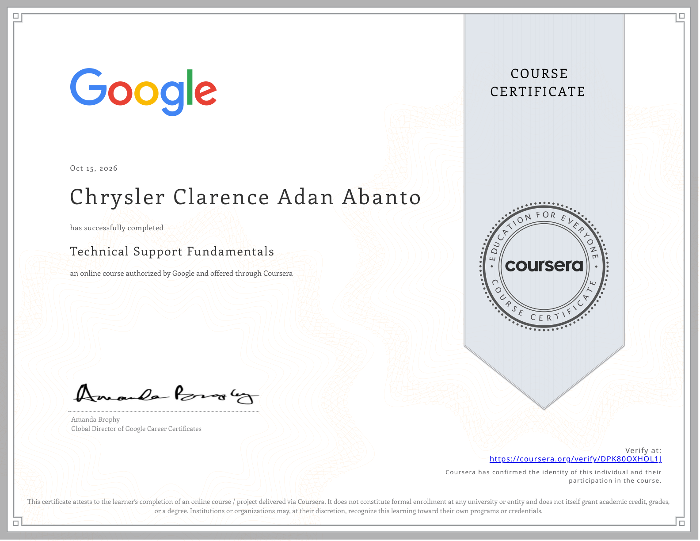

---

## 👨‍💻 About Me

Hey there! I'm **Chrysler**, a BSIT student from the Philippines building my path as a software developer — one project at a time.

- 🔭 Currently building Python GUI projects and exploring backend development
- 🌱 Learning Python, Tkinter, Git & GitHub, MySQL, and web development
- 👯 Open to collaborating on beginner-friendly Python projects and student tools
- 💬 Ask me about Python, Tkinter, MySQL, and beginner projects
- 📫 Email: **chrysler.clarence19@gmail.com**
- 🌐 Portfolio: [Visit my portfolio](https://chryslerclarencewebsiteportfolio.my.canva.site/)

---

## 🛠️ Languages & Tools

  &nbsp;
  &nbsp;
  &nbsp;
  &nbsp;
  &nbsp;
  &nbsp;
  

---

## 🏆 Certifications

### Google — Technical Support Fundamentals

Completed **October 15, 2026**. An online course authorized by Google and offered through Coursera.

**[Verify this certificate on Coursera](https://coursera.org/verify/DPK80OXHOL1J)**

### freeCodeCamp — Scientific Computing with Python

  

---

## 📊 GitHub Stats

&nbsp;

---

## 🏅 GitHub Trophies

---

## 🤝 Connect With Me

  &nbsp;
  &nbsp;
  &nbsp;
  

> **Note:** Add your Facebook and Stack Overflow links here once you have the exact profile URLs. The original Facebook URL contained spaces, and the Stack Overflow URL did not use the usual numeric user-profile format.

---

